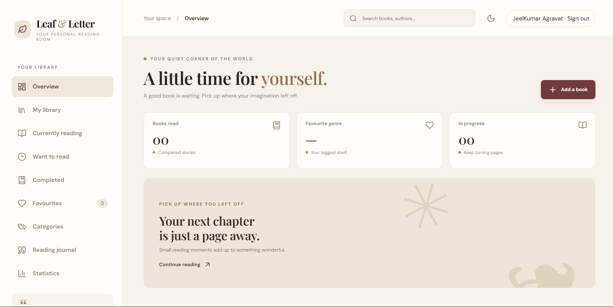
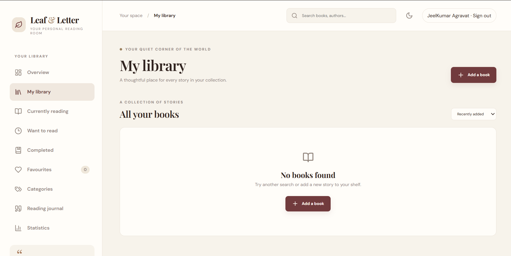
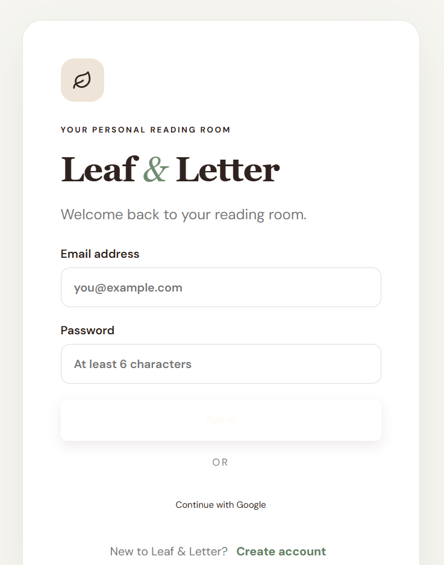
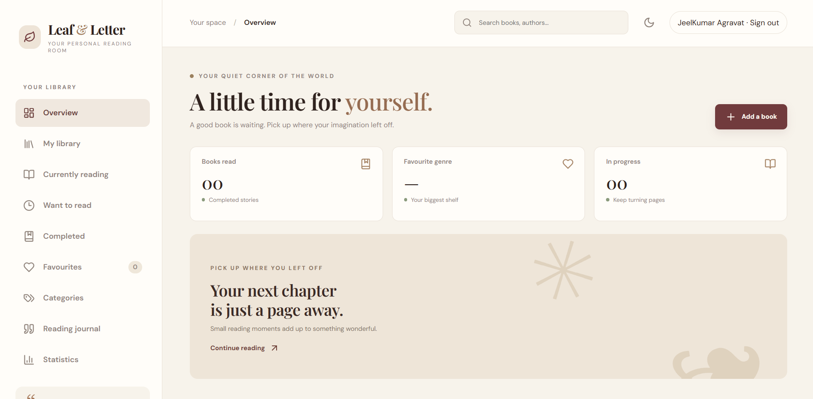
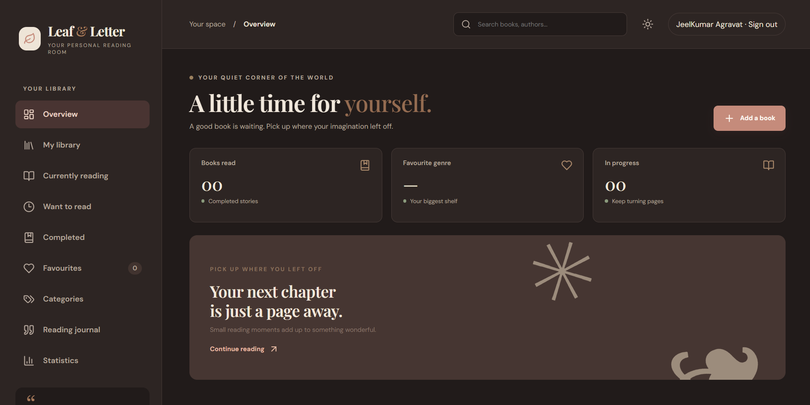

<div align="center">


# Leaf & Letter 🌿

### Every book leaves a story. Every page leaves a mark.

</div>

# 🌿 Leaf & Letter

### Every book leaves a story. Every page leaves a mark.

**Your personal digital library. A beautiful space for every story you read.**

[Live Website](https://leaf-and-letter-jade.vercel.app) · [Report a Bug](https://github.com/Jeelkumar03/leaf-and-letter/issues) · [GitHub Repository](https://github.com/Jeelkumar03/leaf-and-letter)

<br/>

*Read. Remember. Reflect.*

</div>

---

## 📖 About the Project

**Leaf & Letter** is a personal digital library designed to bring your reading life into one beautifully organized space.

It provides a dedicated environment to keep track of the books you read, maintain your reading collection, and preserve your personal reading journey.

Inspired by the warmth of traditional libraries and the elegance of editorial design, Leaf & Letter combines a sophisticated visual experience with modern web technologies.

Whether you're reading your first book or maintaining a lifelong collection, Leaf & Letter gives every book a place and every reading journey a story.

## 🖼️ Application Preview

### Dashboard


### Personal Library


### Authentication


### Light Theme


### Dark Theme


## ✨ Features

### 📚 Personal Digital Library
- Maintain your personal book collection.
- Keep your reading library organized.
- Access your library through your account.
- Persist your library data using Firebase Firestore.

### 🔐 Authentication
- Create an account using email and password.
- Sign in using Google authentication.
- Secure, user-specific library access.
- Manage your personal library independently.

### 🎨 Elegant User Interface
- Modern editorial library aesthetic.
- Warm cream backgrounds.
- Chocolate brown and burgundy brand palette.
- Elegant serif typography paired with modern sans-serif typography.
- Responsive layouts for different screen sizes.

### 🌙 Light & Dark Themes
- Light theme for a warm reading experience.
- Dark theme for comfortable viewing.
- Consistent visual identity across themes.

### 📱 Progressive Web Application
- Installable application experience.
- Responsive across desktop, tablet, and mobile.
- Application icons and PWA metadata.
- Service worker support.
- Caching of the application shell and selected static assets.

---

## 🎨 Brand Identity

Leaf & Letter follows a modern editorial library design philosophy.

| Element | Specification |
|---|---|
| Brand Name | Leaf & Letter |
| Tagline | Every book leaves a story. Every page leaves a mark. |
| Primary Colours | Chocolate Brown & Burgundy |
| Background | Warm Cream |
| Typography | Elegant Serif + Modern Sans-serif |
| Design Language | Modern Editorial Library |
| Application Type | Progressive Web Application |
| Themes | Light & Dark |

The visual identity is designed to feel warm, sophisticated, minimal, and timeless.

---

## 🛠️ Technology Stack

Leaf & Letter is built using modern web technologies.

| Technology | Purpose |
|---|---|
| React 18 | Frontend user interface |
| Vite 6 | Development server and build tooling |
| JavaScript | Application development |
| Firebase Authentication | User authentication |
| Cloud Firestore | Cloud database and library persistence |
| Lucide React | Interface icons |
| Vite PWA Plugin | Progressive Web App functionality |
| Vercel | Application hosting and deployment |
| Git & GitHub | Version control and source management |

---

## 🏗️ Application Architecture

Leaf & Letter follows a client-side application architecture.

**Application Flow:**

```text
                USER
                  |
                  v
          React Application
                  |
          +-------+-------+
          |               |
          v               v
     Authentication   Application UI
          |               |
          v               v
       Firebase       Library Features
          |               |
          +-------+-------+
                  |
                  v
             Firestore
                  |
                  v
          User-specific Data
```

### Architecture Components

**Frontend**
- React handles the application interface and user interactions.
- Vite provides the development and production build environment.
- Lucide React provides interface icons.

**Authentication**
- Firebase Authentication manages user sign-in and registration.
- Supports email/password and Google authentication.

**Database**
- Cloud Firestore stores user-specific library information.
- Security rules restrict access to the authenticated user's own data.

**Hosting**
- Vercel hosts the production application.
- GitHub integration supports automated deployments.

---

## 🚀 Getting Started

Follow these instructions to run Leaf & Letter locally.

### 1. Prerequisites

Install the following:

- Node.js
- npm
- Git
- Visual Studio Code (recommended)
- A Firebase project

### 2. Clone the Repository

```bash
git clone https://github.com/Jeelkumar03/leaf-and-letter.git
```

Navigate into the project:

```bash
cd leaf-and-letter
```

### 3. Install Dependencies

```bash
npm install
```

### 4. Configure Firebase Environment Variables

Create a `.env` file in the root directory, alongside `package.json`.

Add your Firebase Web App configuration:

```env
VITE_FIREBASE_API_KEY=your_api_key
VITE_FIREBASE_AUTH_DOMAIN=your_auth_domain
VITE_FIREBASE_PROJECT_ID=your_project_id
VITE_FIREBASE_STORAGE_BUCKET=your_storage_bucket
VITE_FIREBASE_MESSAGING_SENDER_ID=your_messaging_sender_id
VITE_FIREBASE_APP_ID=your_app_id
```

Replace the placeholder values with your actual Firebase project configuration.

**Important:** Never commit your `.env` file to GitHub.

### 5. Start the Development Server

```bash
npm run dev
```

Vite will provide a local development URL, typically:

```text
http://localhost:5173
```

Open the URL in your browser.

### 6. Build for Production

```bash
npm run build
```

The production build will be generated inside:

```text
dist/
```

To preview the production build locally:

```bash
npm run preview
```

---

## 🔥 Firebase Configuration

Leaf & Letter uses Firebase for authentication and cloud data persistence.

### Authentication Setup

1. Open the Firebase Console.
2. Select your Firebase project.
3. Navigate to Authentication.
4. Open Sign-in Method.
5. Enable:
   - Email/Password
   - Google

### Firestore Setup

1. Open Firestore Database.
2. Create a database if one does not already exist.
3. Navigate to the Rules section.
4. Publish the security rules provided in:

```text
firestore.rules
```

### Security

The Firestore security rules are designed to ensure that authenticated users can access only their own private library documents.

Never use unrestricted rules such as:

```javascript
allow read, write: if true;
```

Firebase client configuration is not a substitute for database security. Access control must be enforced through Firebase Authentication and Firestore Security Rules.

---

## 🌐 Deployment

Leaf & Letter is configured for deployment using GitHub and Vercel.

### Deploy with Vercel

1. Push your project to GitHub.
2. Open [Vercel](https://vercel.com/).
3. Sign in using GitHub.
4. Select **Add New → Project**.
5. Import the `leaf-and-letter` repository.
6. Configure the following:

| Setting | Value |
|---|---|
| Framework Preset | Vite |
| Build Command | `npm run build` |
| Output Directory | `dist` |
| Install Command | `npm install` |

### Configure Environment Variables

Add all six Firebase environment variables in Vercel:

- `VITE_FIREBASE_API_KEY`
- `VITE_FIREBASE_AUTH_DOMAIN`
- `VITE_FIREBASE_PROJECT_ID`
- `VITE_FIREBASE_STORAGE_BUCKET`
- `VITE_FIREBASE_MESSAGING_SENDER_ID`
- `VITE_FIREBASE_APP_ID`

Apply them to the required deployment environments.

### Configure Firebase Authorized Domains

After deployment:

1. Open Firebase Console.
2. Navigate to Authentication → Settings.
3. Open Authorized Domains.
4. Add your Vercel deployment hostname.

For example:

```text
your-project.vercel.app
```

Once configured, deploy the application.

**Live Application:** [Leaf & Letter](https://leaf-and-letter-jade.vercel.app)

---

## 📱 Install as an Application

Leaf & Letter supports installation as a Progressive Web Application.

### Android

1. Open the deployed website in Chrome.
2. Open the browser menu.
3. Select Install App or Add to Home Screen.
4. Complete the installation.

### iPhone / iPad

1. Open the website in Safari.
2. Tap the Share button.
3. Select Add to Home Screen.
4. Confirm the installation.

### Desktop

1. Open the website in a supported browser.
2. Look for the installation icon in the browser's address bar.
3. Select Install.

**Offline Availability:** The application shell and selected static assets can be cached for repeat visits. Authentication and Firestore operations require an internet connection. Full offline library editing and synchronization are not currently supported.

---

## 🔒 Security & Privacy

Security is an important part of Leaf & Letter.

The application uses:

- Firebase Authentication for identity management.
- Firestore Security Rules for user-specific data access.
- Environment variables for Firebase client configuration.
- Git ignore rules to prevent accidental commits of local environment files.

Users should never share private credentials or Firebase service-account keys.

---

## 📌 Current Project Scope

The current implementation includes:

- React + Vite application.
- Firebase email/password authentication.
- Google authentication.
- User-specific Firestore library persistence.
- Responsive application interface.
- Light and dark themes.
- Installable PWA configuration.
- Vercel deployment configuration.
- Firestore security rules.

### Current Limitations

- Cloud-based library operations require internet connectivity.
- Full offline editing and synchronization are not implemented.
- Existing browser-only data from earlier versions is not automatically migrated to Firestore.
- The application currently uses a Vercel-provided domain.

---

## 🔄 Updating the Application

The project uses a GitHub → Vercel deployment workflow.

Whenever you make changes:

```bash
git add .
git commit -m "Describe your changes"
git push origin main
```

Vercel automatically starts a new deployment when changes are pushed to the connected production branch.

---

## 🗺️ Project Vision

Leaf & Letter aims to become more than a simple book tracker.

The long-term vision is to create a personal digital reading sanctuary where readers can organize their collections, document their reading journeys, preserve meaningful passages, and build a lasting relationship with the books they read.

The goal is simple:

**Make every book count. Make every page memorable.**

---

## 👨‍💻 Author

**Jeel Agravat**

Creator and Developer of Leaf & Letter.

- GitHub: [@Jeelkumar03](https://github.com/Jeelkumar03)
- Project Repository: [leaf-and-letter](https://github.com/Jeelkumar03/leaf-and-letter)

---

<div align="center">

### 🌿 Leaf & Letter

*Every book leaves a story. Every page leaves a mark.*

**Built with care, for people who love reading.**

</div>
